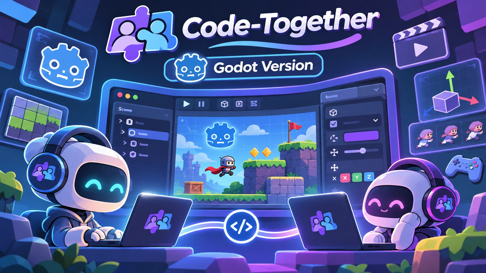

# Code Together for Godot

A Godot 4.6 editor add-on written in GDScript. The current development build includes 3D viewport drawing and shares the local display name and favorite color with the Unity and Unreal adapters on Windows. Session integration is in development.

## Install from source

1. Open the included `project.godot` and load `scenes/drawing_preview.tscn` to try the add-on. For another project, copy `addons/code_together` into its `addons` directory and enable **Code Together** under **Project Settings > Plugins**.
2. Open the dock from **Project > Tools > Code Together**.
3. In a saved 3D scene, click **Drawing Tools** in the 3D toolbar or use **Misc > Drawing > Open Drawing Tools** in the dock.

Use the 3D toolbar or the dock to pick a tool. Right-click or press Escape to cancel an active placement. Scroll while using **Erase Brush** to change its radius.

Run `godot --headless --path . --script res://tests/test_adapter.gd` from the repository root to check the adapter.

[Code Together overview](https://github.com/KD-Kevin/code-together) · [Shared Perspective](https://github.com/KD-Kevin/Shared-Perspective)
